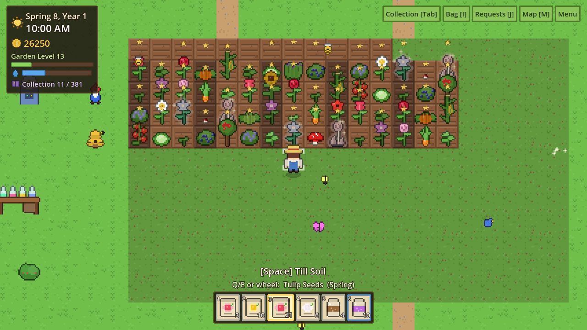
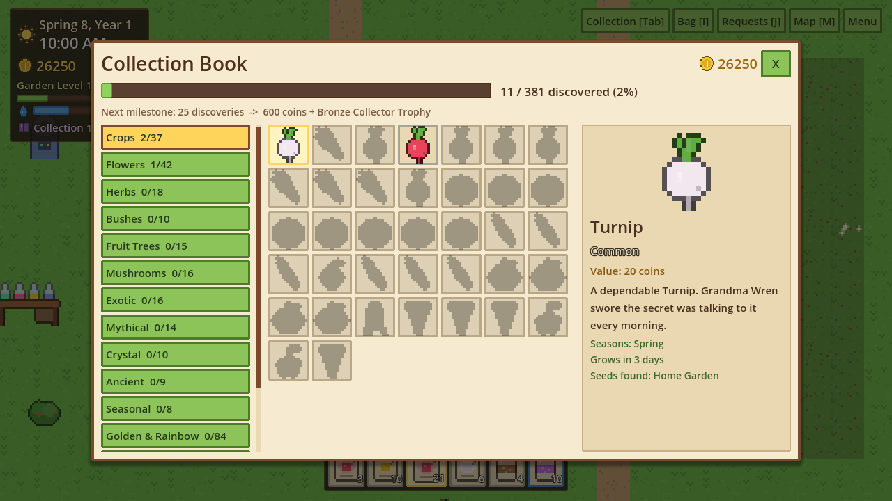
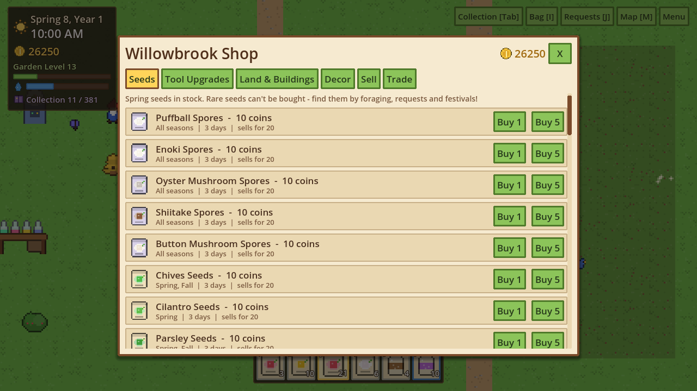
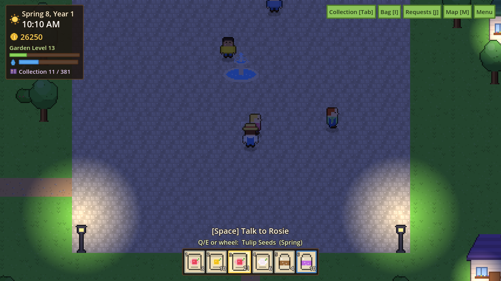

# 🌱 Bloomfolk Gardens

A cozy pixel-art **gardening & collection game** made in **Godot 4** (GDScript).
Grow, discover and catalog **381 collectibles** — crops, flowers, herbs, fruit trees,
mushrooms, exotic, mythical, crystal and ancient plants, golden & rainbow mutations,
tools, decor and treasures — and build the ultimate dream garden.



| Collection Book | Village Shop | Night in the village |
|---|---|---|
|  |  |  |

## ▶️ How to play it

1. Install **Godot 4.3+** (standard version, not .NET): https://godotengine.org/download
2. Clone or download this repo.
3. Open Godot → **Import** → select `project.godot` → **Import & Edit**.
4. Press **F5** (Play). No other setup — every sprite is generated in code.

## 🎮 Controls

| Action | Keys |
|---|---|
| Move / Run | WASD or Arrows / Shift |
| Use (till, plant, water, harvest, forage, talk, interact) | Space or Left-click |
| Pick up decor / clear plot | X or Right-click |
| Choose held seed / fertilizer / decor | Q / E, mouse wheel, 1–9 |
| Collection Book · Bag · Requests · Map · Menu | Tab · I · J · M · Esc |

Gamepad is supported too (A = use, X = clear, bumpers = hotbar, Y = book, Start = menu).

## 🔁 Core loop

**Explore → Forage → Grow → Harvest → Earn → Unlock seeds & tools → Expand → Discover rare plants → Complete collections**

- **Gardening:** till → plant → water daily → fertilize → harvest. Plants show 5 growth stages and sway in the wind.
- **Seasons:** 10-day seasons; plants grow only in their season outdoors. The **Greenhouse** ignores seasons.
- **Mutations:** every flower can mutate **Golden** or **Rainbow** on harvest (boosted by Magic Mulch, the Magical Garden, sickle upgrades and a Four-Leaf Clover).
- **Special plants:** Mythical, Crystal and Ancient plants need Starlight Fertilizer, Crystal Dust or Ancient Compost.
- **9 regions:** Home Garden, Willowbrook Village, Flower Fields, Whispering Forest, Mushroom Caves, Misty Mountains, Fairy Garden, Crystal Hollow, Ancient Ruins — each with unique forage loot. Silver Shovel digs relics in the Mountains & Ruins.
- **Progression:** Garden Level XP, 6 tools × 5 tiers (bigger areas, more yield, better luck), 9 garden expansions (plots, Greenhouse, Rare Seed Station, Plant Laboratory, Patio, Magical Garden).
- **Economy:** sell crops, daily villager requests (with rare seed rewards), trading, and seasonal **festivals** (day 7) with exclusive seeds.
- **Collection Book:** rarity, value, lore and growing conditions for every entry, category completion rewards, and milestone trophies.
- **Cozy:** day/night with lamps that glow, rain/snow/wind, butterflies, bees, birds, fireflies, wandering villagers, placeable decor.
- **Saving:** autosave on sleep and every 2 minutes, manual save in the menu (`user://bloomfolk_save.json`).

## 🗂️ Project structure

```
scenes/Main.tscn            entry scene
scripts/main.gd             game flow, input map, day cycle, sleeping
scripts/autoload/
  item_db.gd                ALL items & collectibles (data tables)
  pixel_art.gd              procedural pixel-art generator (every sprite)
  game_state.gd             player progress + rules (growth, XP, requests, milestones)
  save_manager.gd           JSON save/load + autosave
  events.gd                 global signal bus
scripts/world/              world builder, player, villagers, critters, weather FX
scripts/ui/                 theme, HUD, all menus
tools/                      dev tools: art preview sheet + automated smoke test
```

### Adding content
- **New plant:** add one line to a table in `item_db.gd`, e.g.
  `["Moon Melon", "s", 2, "gourd", "c8d0ff", "", {}]` — it gets art, seeds, a book entry, growth and prices automatically.
- **Custom art:** return your own textures from `PixelArt.plant_tex()` / `icon()` / `object_tex()`.

### Dev tools
```
godot --headless --path . --script res://tools/art_preview.gd   # writes sprite sheets
godot --path . --script res://tools/smoke_test.gd               # automated play-through
```

Made with Godot 4.3 · GDScript · Compatibility renderer.
